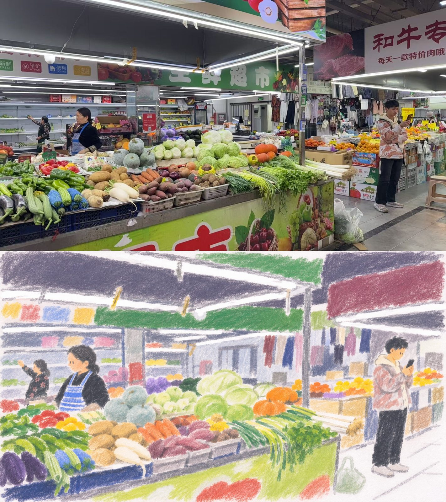
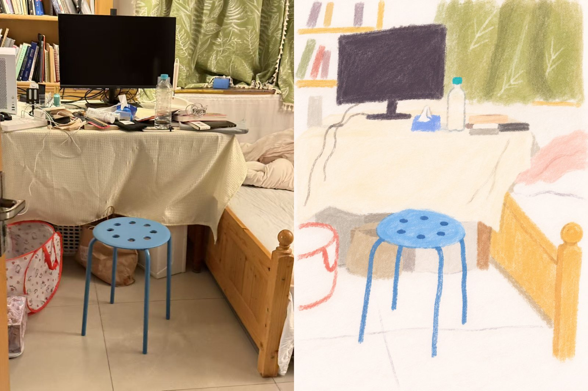
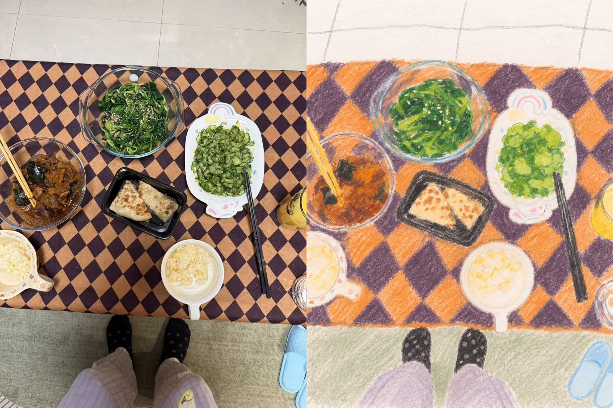
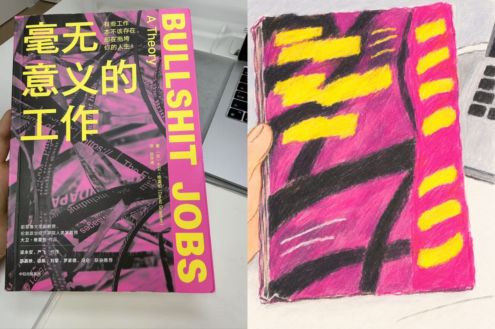

# kurai-life

[中文](README.md) | **English**

Turn everyday photos into naive, handmade art-zine drawings.
Rubbed color, loose lines, and bare paper share the page.
Keep the everyday gestures and the awkward, uneven shapes.

Works with people, animals, rooms, street scenes, and everyday objects. It keeps the original composition while simplifying details and varying the weight of color and line.

## Before and after

Portrait images show the original on the left and the drawing on the right. Landscape images show the original above the drawing.

### Market



### Room



### Table



### Book



## Usage

After installing the skill, attach a photo and enter:

```text
Use $kurai-life to transform this photo.
```

See [SKILL.md](SKILL.md) for the workflow and [references](references) for the visual references.