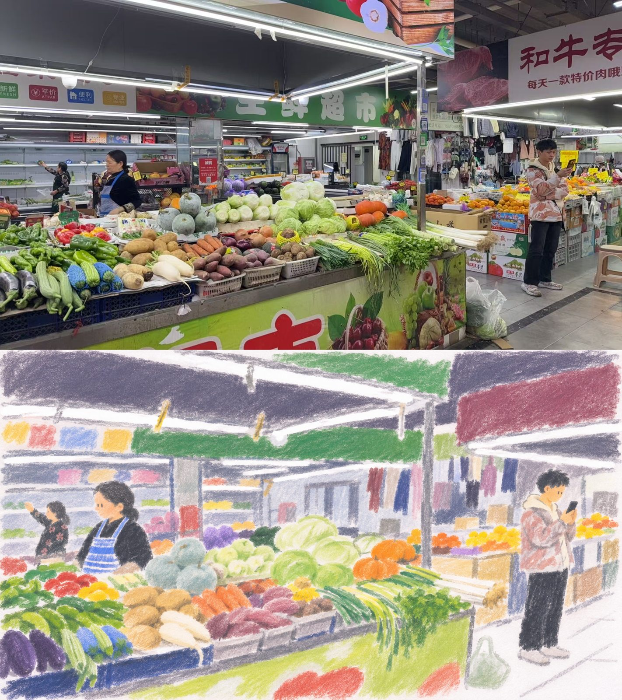
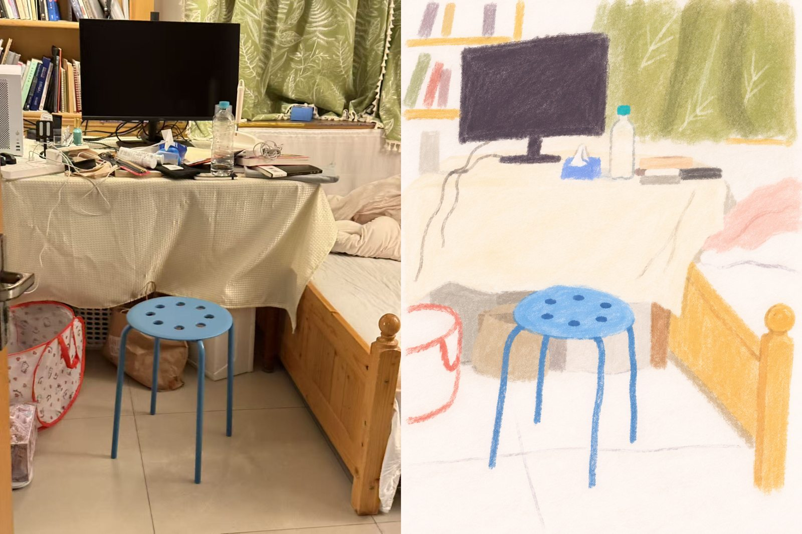
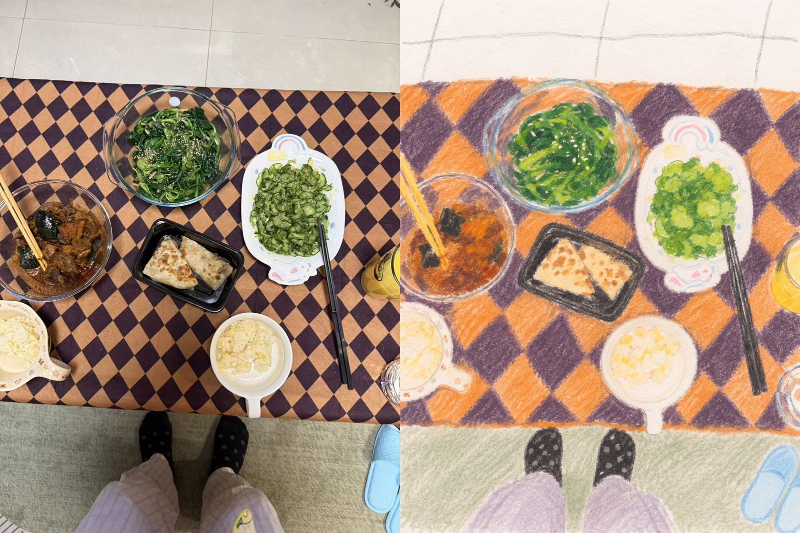
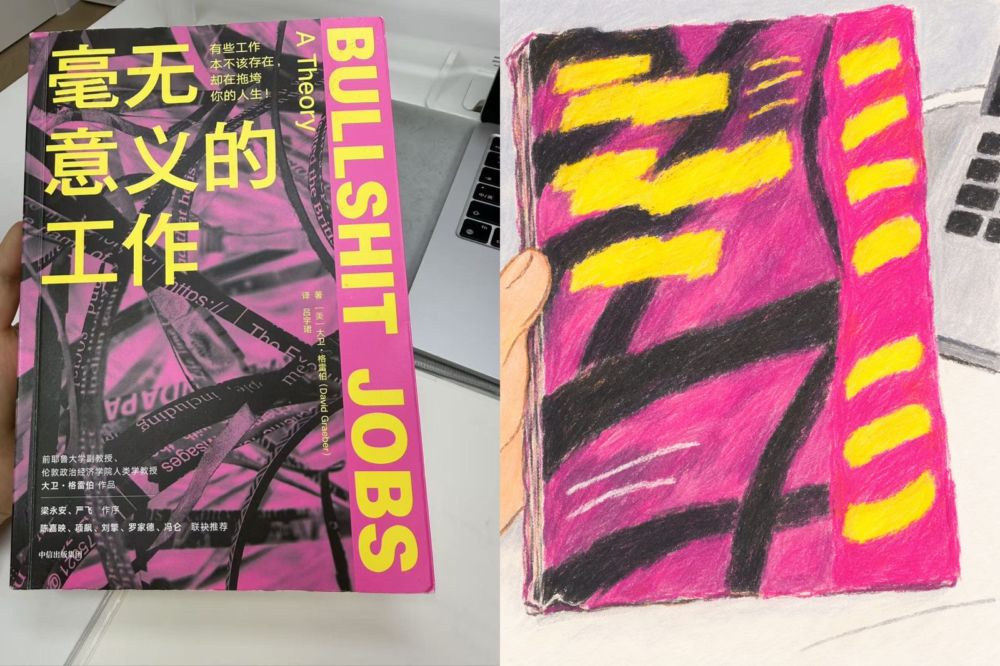

# kurai-life

**中文** | [English](README.en.md)

把生活照片画成稚拙的个人艺术小册子。
揉擦色块、随手细线和纸白交织。
保留日常姿态，也保留不规整的笨拙感。

适合人物、动物、房间、街景和日常物品。沿用原图构图，简化细节，让颜色和线条自然变化。

## 效果对比

竖图左边为原图，右边为处理结果。横图上方为原图，下方为处理结果。

### 菜市场



### 房间



### 餐桌



### 书本



## 使用

安装后发送照片，并输入：

```text
用 $kurai-life 处理这张照片
```

技能说明见 [SKILL.md](SKILL.md)，风格参考位于 [references](references)。